<p align="center">
  
</p>

<h3 align="center">Ciao, I'm Alessandro 👋</h3>

<p align="center">
  Co-founder of <a href="https://www.wisedigitalstudio.com">Wise Digital Studio</a>, near Como, Italy.<br>
  I write <b>.NET</b> for a living and <b>Lua</b> for fun, so I can keep writing .NET from <b>Neovim</b>.
</p>

<p align="center">
  
</p>

---

### `:Lazy` — what I'm building

The IDE bits I was missing when I moved my .NET work into Neovim:

| | Plugin | What it does |
|---|---|---|
| 🌳 | [**dotnet-tree.nvim**](https://github.com/alessandropietrobelli/dotnet-tree.nvim) | A solution explorer as a neo-tree source: the solution graph — folders, projects, references, packages — not the folder tree. Build, run, test and watch from it. |
| 📦 | [**nuget.nvim**](https://github.com/alessandropietrobelli/nuget.nvim) | One floating window for the NuGet packages of the whole solution: browse, update, consolidate, audit vulnerabilities and deprecations. |
| 📈 | [**dotnet-counters.nvim**](https://github.com/alessandropietrobelli/dotnet-counters.nvim) | Live CPU, memory, GC, thread pool and HTTP metrics in a side panel, opened next to nvim-dap while you debug. |

### `git log --graph --oneline`

```text
*   2026  merge: Neovim + .NET, the IDE bits I was missing
|\
| * dotnet-counters.nvim   live runtime metrics next to the debugger
| * nuget.nvim             NuGet for the whole solution, in one window
| * dotnet-tree.nvim       the solution graph, not the folder tree
|/
*   ····  feat!: co-found Wise Digital Studio, .NET + Azure
*   2018  feat: Angular & TypeScript front-ends
*   2014  feat: the Laravel 4 years (confide, ardent, entrust, oauth2-server)
*   2012  init: Zend Framework 2, AP_XmlStrategy
```

### `:checkhealth alessandro`

```text
alessandro
- OK  editor: Neovim, for C# too
- OK  language: C#, still learning Lua the hard way
- OK  issues and PRs on my plugins: very welcome
- WARNING  tabs open: more than strictly necessary
```

<p align="center">
  <a href="https://www.wisedigitalstudio.com"></a>
  <a href="https://github.com/WiseDigitalStudio"></a>
</p>

<p align="center"><sub>The header is a hand-written SVG, no Neovim was harmed. <code>:wq</code></sub></p>
